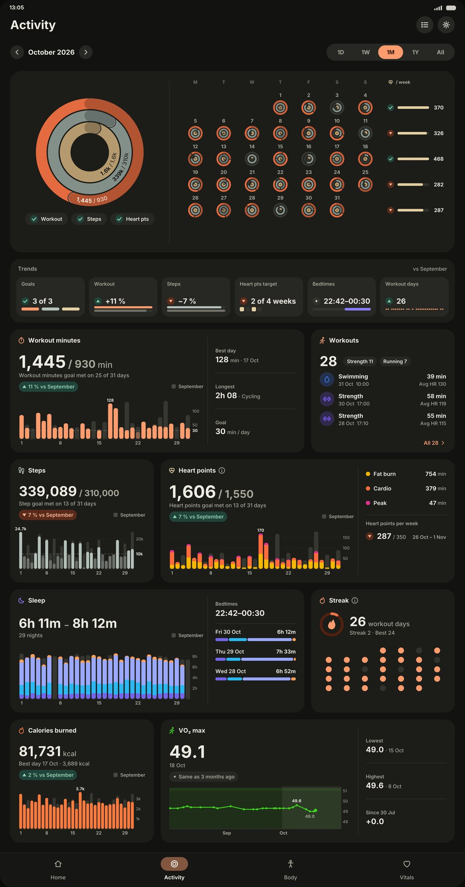
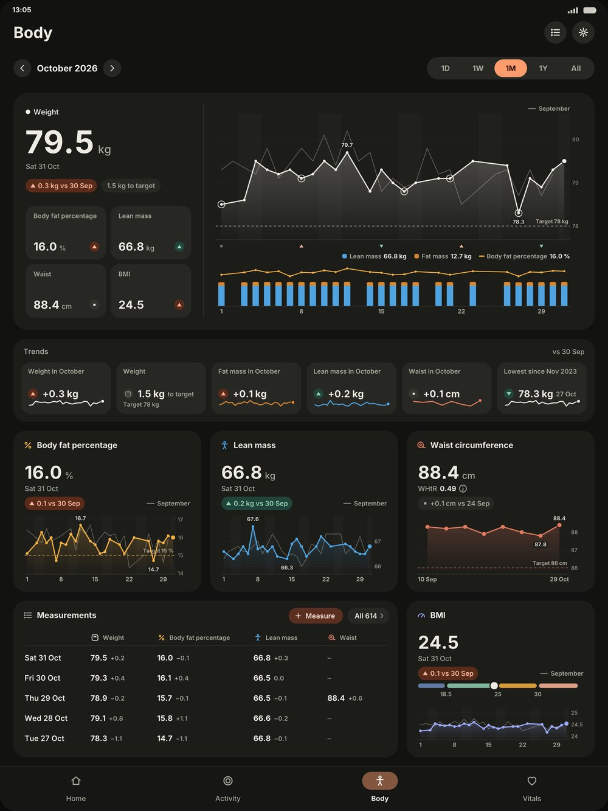
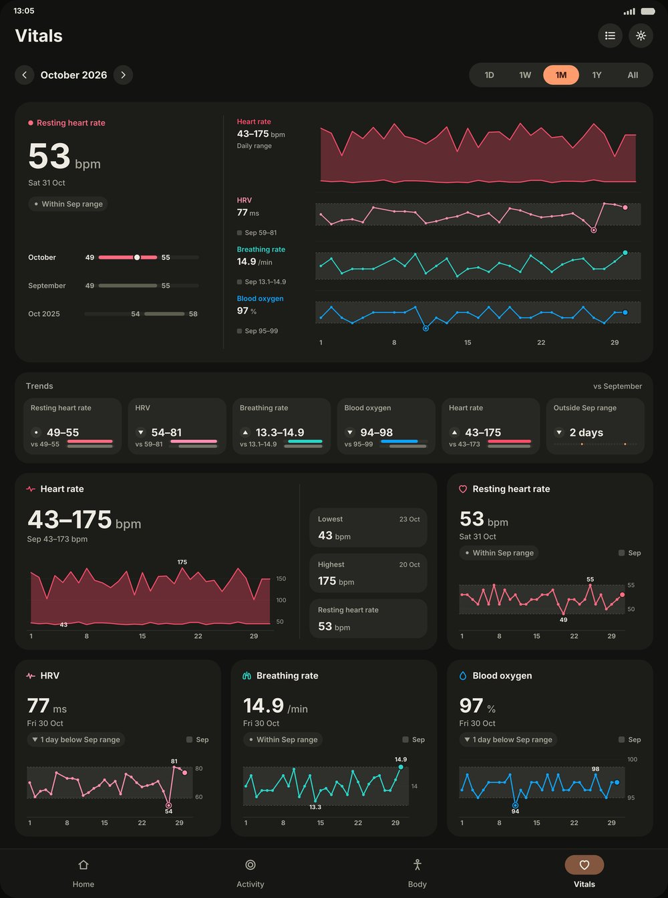
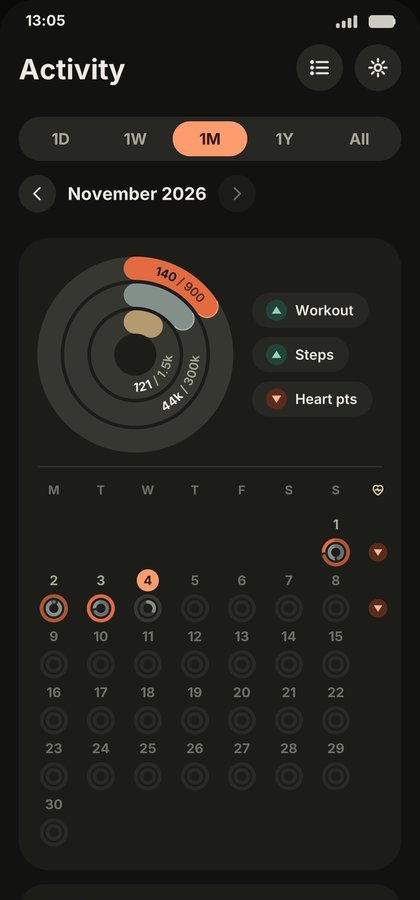

# Health BB

A personal health dashboard for Android. Health BB reads **Health Connect** (where Google Health / Fitbit, Withings and other apps write their data) and shows it as activity rings, section dashboards and home-screen widgets. Read-only: it never writes, changes or deletes health data.

- **Home**: your own tile dashboard (pick tiles and sizes).
- **Activity**: the period's rings next to a month calendar of daily rings, a Trends strip (change vs the previous period, goals met, records, streaks, bedtimes), and cards for workout minutes, workouts, steps, heart points and zones, sleep, streak, calories burned and VO₂ max. Periods 1D / 1W / 1M / 1Y / All, swipe between them, tap a day to re-scope the whole tab.
- **Body**: weight with lean/fat composition on one timeline, body fat, lean mass, waist (incl. a Renpho smart tape over Bluetooth) and BMI, targets, and trends built for noisy scales (week-lowest, weeks down, change per month).
- **Vitals**: resting heart rate next to heart rate, HRV, breathing rate and blood oxygen on one shared timeline, each against the previous period's lowest–highest range.
- Trends are facts: changes, ranges, records and counts.
- **All metrics** list and per-metric pages.
- **Widgets**: *Health BB* (configurable tiles) and *Health BB · Clock* (rings + clock, several styles).
- Optional one-time import of an Apple Health export (`export.zip`).

Heart points follow the Fitbit Active Zone Minutes method on heart-rate reserve (fat burn ×1, cardio and peak ×2). The weekly target defaults to 150 (WHO) and can be changed.

<p>
  
  
</p>
<p>
  
  
</p>

*Design mock-ups of the Activity, Body and Vitals tabs (Fold inner and cover screen) with made-up data.*

## Disclaimer

Hobby software, not a medical device and not medical advice. Not affiliated with, endorsed by or supported by Google, Fitbit, Withings, Apple or Renpho. Numbers can be wrong; use at your own risk. No warranty of any kind (see `LICENSE`). Product names are trademarks of their respective owners.

## Build and install

Requirements: Android 14+ (minSdk 34) with Health Connect; Android Studio with SDK 37 (or JDK 21 + Android SDK on the command line).

```bash
./gradlew installDebug        # builds and installs on a connected phone (USB or wireless debugging)
```

Then open Health BB → **Allow** → in Health Connect switch on all items, including *Access data in the background* and *Access past data*. The first start reads all history; that takes a few minutes. Set your profile and goals in Settings. Add the widgets from the home-screen widget picker.

Set the app's battery usage to *Unrestricted* if background refresh (every 30 minutes) should run on time.

## Optional: Google Health connection (VO₂ max)

Google Health shows VO₂ max but does not write it to Health Connect. Health BB can read it directly from the
[Google Health API](https://developers.google.com/health) (read-only, on the phone, no server). Nothing goes online
unless you connect it in Settings → Data & sync → Google Health.

To use it you need your own Google Cloud project (free, no billing account):

1. Create a project, enable the **Google Health API**.
2. Google Auth Platform: Branding (app name + your e-mail), Audience **External**, add yourself as **test user**.
3. Data Access: add `userinfo.email`, `googlehealth.health_metrics_and_measurements.readonly`, `googlehealth.activity_and_fitness.readonly`.
4. Clients → **Android** client with package `com.boudhealth` (or your own applicationId) and the SHA-1 of the key you sign with
   (`keytool -list -v -keystore ~/.android/debug.keystore -alias androiddebugkey -storepass android`).

No client ID or secret goes into the code. In Testing mode Google asks you to reconnect every 7 days; the app shows a notification.

## Project

See `HANDOVER.md` for the architecture, conventions and the backlog.

## Licence

MIT, see `LICENSE`. No binaries are distributed; build it yourself.
